# GymFlow — Project Report

**DBMS Experiential Learning — Level 3 Project**

| | |
|---|---|
| Project | GymFlow: Gym Membership and Workout Progress Tracker |
| Team | Akarsh Kumar Gupta (PES1UG24AM021), Aryan Arora (PES1UG24AM055), Ashwin Anand (PES1UG24AM057) |
| Stack | Next.js 16 · PostgreSQL 17 · MongoDB 7 |
| Repository | https://github.com/ASHWINANAND19/gymflow |

---

## Contents

1. [Problem statement](#1-problem-statement)
2. [Objectives](#2-objectives)
3. [Scope](#3-scope)
4. [Functional requirements](#4-functional-requirements)
5. [ER diagram](#5-er-diagram)
6. [Relational schema](#6-relational-schema)
7. [Database choice and justification](#7-database-choice-and-justification)
8. [Data dictionary](#8-data-dictionary)
9. [Database implementation](#9-database-implementation)
10. [Important queries](#10-important-queries)
11. [System architecture](#11-system-architecture)
12. [Application screenshots](#12-application-screenshots)
13. [Testing results](#13-testing-results)
14. [Conclusion and future enhancements](#14-conclusion-and-future-enhancements)
15. [Team contribution](#15-team-contribution)
16. [Demo walkthrough](#16-demo-walkthrough)

---

## 1. Problem statement

Small and mid-sized gyms usually run on paper registers, spreadsheets and WhatsApp messages. This causes real problems:

- **Lapsed members keep training.** Nobody checks at the door whether a membership is still valid.
- **Renewals get mixed up.** A member who renews early either loses days or gets an overlapping plan.
- **Trainers get overloaded.** Clients are handed out without tracking how many each trainer already has.
- **No one can see progress.** Workout notes are scattered or lost, so members and trainers can't tell whether training is working.
- **Owners lack numbers.** Monthly revenue, expiring memberships and low-attendance members are hard to find.

GymFlow puts these into one system. Rules such as "no check-in without a valid membership" or "a trainer cannot exceed their capacity" are enforced **by the database itself**, so no screen or API bug can bypass them.

## 2. Objectives

1. Design a normalised relational schema for members, plans, memberships, payments, attendance and trainer assignments, with proper keys and constraints.
2. Enforce business rules at the database level using constraints, triggers, a stored procedure and transactions.
3. Store flexible, nested workout data in MongoDB with schema validation, and analyse it with aggregation pipelines.
4. Provide role-based access for three roles (admin, trainer and member), with secure authentication.
5. Build a Next.js web interface that shows the database features in action: dashboards, filters, charts and forms.
6. Justify the use of each database through the shape of its data.

## 3. Scope

**In scope**
- Member self-registration, login and role-based access (admin, trainer, member)
- Plans, purchase and renewal (with queued start dates), and payment records
- Gym check-in/check-out with membership validation
- Trainer capacity, assignment rules and weekly workout plans
- Workout logging (strength, cardio, flexibility), progress charts and personal records
- Admin dashboard, member search, payment reports and an audit log

**Out of scope**
- Real online payment processing (payments are recorded, not charged)
- Notifications (email/SMS), mobile apps, biometric or QR check-in hardware
- Multi-branch gyms and class/slot booking

## 4. Functional requirements

| ID | Requirement | Role |
|---|---|---|
| FR1 | Users log in with email and password. Passwords are stored hashed. | All |
| FR2 | A visitor can sign up as a member. Members must be 14 or older. | Public |
| FR3 | A member can buy a plan. If a plan is still running, the new one starts the day after it ends. | Member, Admin |
| FR4 | A purchase creates a membership and its payment together, or neither. | System |
| FR5 | A member can check in only on a day covered by an active membership, and only once until checking out. | Member |
| FR6 | A member can log a workout with any mix of strength, cardio and flexibility exercises. | Member |
| FR7 | A member can see weekly training volume, sessions per week and personal records. | Member, Trainer |
| FR8 | A trainer can see only their own clients and write a weekly workout plan for each. | Trainer |
| FR9 | An admin can assign a trainer only if the trainer has capacity and the member's plan includes a trainer. | Admin |
| FR10 | An admin can manage plans. Plans that have been bought cannot be deleted, only deactivated. | Admin |
| FR11 | An admin can search and filter members by name, membership status and plan. | Admin |
| FR12 | An admin can filter payments by date and method and see totals per method. | Admin |
| FR13 | Memberships whose end date has passed are marked expired automatically. | System |
| FR14 | Every membership creation and status change is recorded in an audit log. | System |
| FR15 | An admin can deactivate a member account, which blocks login immediately. | Admin |

## 5. ER diagram

`USERS` is a supertype with two subtypes, `MEMBERS` and `TRAINERS` (ISA / specialisation). The subtypes share the user's primary key. `EXERCISES` is referenced by documents in MongoDB rather than by a foreign key, and `AUDIT_LOG` is written only by a trigger.

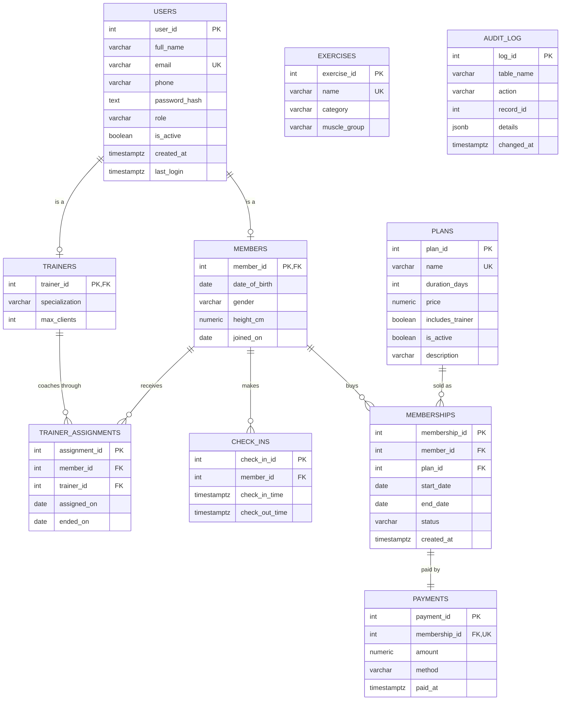

**Cardinalities**

| Relationship | Type | Notes |
|---|---|---|
| User – Member / Trainer | 1 : 0..1 | ISA. Each user is at most one member or one trainer. |
| Member – Membership | 1 : N | Full history of plans |
| Plan – Membership | 1 : N | `ON DELETE RESTRICT`, so a sold plan cannot be deleted |
| Membership – Payment | 1 : 1 | `payments.membership_id` is `UNIQUE` |
| Member – Check-in | 1 : N | |
| Member – Trainer | M : N | Through `TRAINER_ASSIGNMENTS`. At most one *active* assignment per member (partial unique index). |

## 6. Relational schema

Primary keys are **bold**, and foreign keys are marked → referenced table.

- **users** (**user_id**, full_name, email, phone, password_hash, role, is_active, created_at, last_login)
- **members** (**member_id** → users, date_of_birth, gender, height_cm, joined_on)
- **trainers** (**trainer_id** → users, specialization, max_clients)
- **plans** (**plan_id**, name, duration_days, price, includes_trainer, is_active, description)
- **memberships** (**membership_id**, member_id → members, plan_id → plans, start_date, end_date, status, created_at)
- **payments** (**payment_id**, membership_id → memberships [unique], amount, method, paid_at)
- **trainer_assignments** (**assignment_id**, member_id → members, trainer_id → trainers, assigned_on, ended_on)
- **check_ins** (**check_in_id**, member_id → members, check_in_time, check_out_time)
- **exercises** (**exercise_id**, name, category, muscle_group)
- **audit_log** (**log_id**, table_name, action, record_id, details, changed_at)

**Normalisation:** every table is in 3NF.
- Every non-key attribute depends only on its table's key.
- Plan details are not copied into memberships, and member details are not copied into payments. The exception is `payments.amount`, which stores the price *at the time of purchase*: that is a historical fact, not a duplicate, since a plan's price can change later.
- Role-specific attributes live in the subtype tables, so `users` has no columns that are always NULL for one role.

## 7. Database choice and justification

### PostgreSQL: identity, money and rules

| Data | Why relational |
|---|---|
| Users, members, trainers | Fixed attributes, unique emails, an ISA hierarchy that maps cleanly to tables |
| Plans, memberships, payments | Money: must be ACID. A purchase writes two rows that must succeed or fail together. |
| Check-ins, trainer assignments | Rules that span tables ("is there an active membership today?", "is the trainer full?") are best enforced by triggers next to the data |
| Reports | JOINs, GROUP BY/HAVING, views and window functions answer the admin's questions in single queries |

### MongoDB: workout logs and plans

| Data | Why document |
|---|---|
| Workout sessions | One session holds a list of exercises, and each exercise has a different shape: strength has a nested list of sets (reps, kg); cardio has minutes and distance; flexibility has minutes. In SQL this would need 3 or more extra tables, or many nullable columns. |
| Access pattern | A session is always written and read as a whole. One document read beats a 3-table join. |
| Growth | Logs are append-heavy and are the largest dataset, so they are kept out of the transactional database. |
| Analysis | Aggregation pipelines (`$unwind`, `$group`, `$dateTrunc`) compute weekly volume and personal records straight from the nested data. |
| Trainer plans | A plan is a nested week → day → exercises structure that is replaced as a whole when the trainer edits it. |

Flexibility does not mean no rules. Both collections have a **`$jsonSchema` validator**, so MongoDB itself rejects a strength exercise with no sets, negative weights, or an unknown category.

### How the two databases connect

MongoDB documents store PostgreSQL ids (`memberId`, `trainerId`, `exerciseId`). Because no foreign key can span two databases, consistency is handled in the API:

1. Every workout write runs after `requireRole('member')`, which checks in PostgreSQL that the account exists and is active.
2. Exercise names and categories are **looked up in PostgreSQL** and copied into the document. The server never trusts names sent by the browser.
3. A trainer can only write a plan after `isTrainerOfMember()` confirms an active assignment in PostgreSQL.
4. Because names are copied into the documents, deleting an exercise from the catalog never breaks old workout history. This trade-off was made on purpose.

## 8. Data dictionary

### users

| Column | Type | Constraints | Description |
|---|---|---|---|
| user_id | SERIAL | PK | Account id |
| full_name | VARCHAR(100) | NOT NULL, CHECK length ≥ 2 | Display name |
| email | VARCHAR(255) | NOT NULL, UNIQUE, CHECK email pattern | Login id (stored lowercase) |
| phone | VARCHAR(10) | CHECK exactly 10 digits | Optional |
| password_hash | TEXT | NOT NULL | bcrypt hash (cost 10), never plain text |
| role | VARCHAR(10) | NOT NULL, CHECK IN (admin, trainer, member) | Access level |
| is_active | BOOLEAN | NOT NULL, DEFAULT TRUE | FALSE blocks login |
| created_at | TIMESTAMPTZ | NOT NULL, DEFAULT now() | |
| last_login | TIMESTAMPTZ | (added by ALTER) | Updated on each login |

### members

| Column | Type | Constraints | Description |
|---|---|---|---|
| member_id | INT | PK, FK → users ON DELETE CASCADE | Same id as the user |
| date_of_birth | DATE | NOT NULL, CHECK age ≥ 14 (added by ALTER) | |
| gender | VARCHAR(10) | CHECK IN (male, female, other) | Optional |
| height_cm | NUMERIC(5,1) | CHECK 100–250 | Optional |
| joined_on | DATE | NOT NULL, DEFAULT current_date | |

### trainers

| Column | Type | Constraints | Description |
|---|---|---|---|
| trainer_id | INT | PK, FK → users ON DELETE CASCADE | Same id as the user |
| specialization | VARCHAR(50) | NOT NULL | e.g. Weight Loss |
| max_clients | INT | NOT NULL, DEFAULT 10, CHECK 1–30 | Capacity checked by trigger |

### plans

| Column | Type | Constraints | Description |
|---|---|---|---|
| plan_id | SERIAL | PK | |
| name | VARCHAR(50) | NOT NULL, UNIQUE | |
| duration_days | INT | NOT NULL, CHECK > 0 | |
| price | NUMERIC(10,2) | NOT NULL, CHECK > 0 | Rupees |
| includes_trainer | BOOLEAN | NOT NULL, DEFAULT FALSE | Required for trainer assignment |
| is_active | BOOLEAN | NOT NULL, DEFAULT TRUE | FALSE hides it from members |
| description | VARCHAR(200) | (added by ALTER) | |

### memberships

| Column | Type | Constraints | Description |
|---|---|---|---|
| membership_id | SERIAL | PK | |
| member_id | INT | NOT NULL, FK → members ON DELETE CASCADE | |
| plan_id | INT | NOT NULL, FK → plans ON DELETE RESTRICT | |
| start_date | DATE | NOT NULL | First valid day |
| end_date | DATE | NOT NULL, CHECK end_date > start_date | Last valid day (inclusive) |
| status | VARCHAR(10) | NOT NULL, DEFAULT 'active', CHECK IN (active, expired, cancelled) | |
| created_at | TIMESTAMPTZ | NOT NULL, DEFAULT now() | |

### payments

| Column | Type | Constraints | Description |
|---|---|---|---|
| payment_id | SERIAL | PK | |
| membership_id | INT | NOT NULL, UNIQUE, FK → memberships ON DELETE CASCADE | 1:1 with membership |
| amount | NUMERIC(10,2) | NOT NULL, CHECK > 0 | Price at time of purchase |
| method | VARCHAR(10) | NOT NULL, CHECK IN (cash, card, upi) | |
| paid_at | TIMESTAMPTZ | NOT NULL, DEFAULT now() | |

### trainer_assignments

| Column | Type | Constraints | Description |
|---|---|---|---|
| assignment_id | SERIAL | PK | |
| member_id | INT | NOT NULL, FK → members | Partial UNIQUE where ended_on IS NULL |
| trainer_id | INT | NOT NULL, FK → trainers | |
| assigned_on | DATE | NOT NULL, DEFAULT current_date | |
| ended_on | DATE | CHECK ended_on ≥ assigned_on | NULL = still running |

### check_ins

| Column | Type | Constraints | Description |
|---|---|---|---|
| check_in_id | SERIAL | PK | |
| member_id | INT | NOT NULL, FK → members | Validated by trigger |
| check_in_time | TIMESTAMPTZ | NOT NULL, DEFAULT now() | |
| check_out_time | TIMESTAMPTZ | CHECK > check_in_time | NULL = still in the gym |

### exercises

| Column | Type | Constraints | Description |
|---|---|---|---|
| exercise_id | SERIAL | PK | Referenced from MongoDB documents |
| name | VARCHAR(60) | NOT NULL, UNIQUE | |
| category | VARCHAR(12) | NOT NULL, CHECK IN (strength, cardio, flexibility) | Decides which fields a workout entry needs |
| muscle_group | VARCHAR(30) | | |

### audit_log

| Column | Type | Constraints | Description |
|---|---|---|---|
| log_id | SERIAL | PK | |
| table_name | VARCHAR(30) | NOT NULL | Always 'memberships' |
| action | VARCHAR(10) | NOT NULL | INSERT or UPDATE |
| record_id | INT | NOT NULL | membership_id |
| details | JSONB | | Dates/plan for inserts, old/new status for updates |
| changed_at | TIMESTAMPTZ | NOT NULL, DEFAULT now() | |

### MongoDB collection `workout_sessions`

```json
{
  "_id": "ObjectId",
  "memberId": 6,
  "date": "2026-10-31T15:23:00Z",
  "durationMin": 81,
  "notes": "Felt strong today",
  "exercises": [
    { "exerciseId": 1, "name": "Bench Press", "category": "strength",
      "sets": [ { "reps": 10, "weightKg": 35 }, { "reps": 8, "weightKg": 35 } ] },
    { "exerciseId": 13, "name": "Treadmill Run", "category": "cardio",
      "durationMin": 20, "distanceKm": 3.2 },
    { "exerciseId": 17, "name": "Yoga Flow", "category": "flexibility", "durationMin": 25 }
  ],
  "createdAt": "2026-10-31T16:44:00Z"
}
```

| Field | Type | Validation |
|---|---|---|
| memberId | int | required (PostgreSQL member id) |
| date | date | required |
| durationMin | number | 1–300 |
| notes | string | max 500 chars |
| exercises | array | required, at least 1 item |
| exercises[].category | enum | strength, cardio, flexibility |
| exercises[].sets | array | required for strength, at least 1 item; reps int 1–100, weightKg 0–500 |
| exercises[].durationMin | number | required for cardio and flexibility, 1–300 |
| exercises[].distanceKm | number | optional, 0–100 |

**Index:** `{ memberId: 1, date: -1 }`, which serves "this member's sessions, newest first".

### MongoDB collection `workout_plans`

```json
{
  "memberId": 6, "trainerId": 2, "title": "Strength & Conditioning - 4 week block", "active": true,
  "days": [
    { "day": "Mon", "items": [ { "exerciseId": 1, "name": "Bench Press", "targetSets": 4, "targetReps": 10 } ] }
  ],
  "updatedAt": "2026-11-01T07:10:00Z"
}
```

Validation: `day` must be Mon–Sun, `targetSets` 1–10, `targetReps` 1–100, and at least one day with at least one item. **Index:** `{ memberId: 1, active: 1 }`. When a plan is edited, the old document is kept with `active: false` as history.

## 9. Database implementation

All SQL lives in `db/sql/` and runs in order with `npm run db:setup`.

| File | Contents | DDL shown |
|---|---|---|
| `00_drop.sql` | Removes every view, table, function and procedure | **DROP** |
| `01_schema.sql` | 10 tables with PK, FK, UNIQUE, NOT NULL, CHECK | **CREATE TABLE** |
| `02_alter.sql` | Age constraint, `last_login`, `description` | **ALTER TABLE** |
| `03_functions.sql` | `days_remaining`, `expire_memberships`, `purchase_membership` | CREATE FUNCTION / PROCEDURE |
| `04_triggers.sql` | 3 trigger functions + triggers | CREATE TRIGGER |
| `05_views.sql` | 4 views | **CREATE VIEW** |
| `06_indexes.sql` | 4 indexes + 1 partial unique index | **CREATE INDEX** |
| `queries.sql` | 13 documented queries | DML |

### 9.1 Transactions (advanced feature 1)

`lib/db.js` provides `withTransaction()`, which wraps work in `BEGIN … COMMIT` and issues `ROLLBACK` on any error. It is used for:

| Operation | Statements in one transaction | File |
|---|---|---|
| Buy / renew a plan | `CALL purchase_membership(...)`, which inserts into memberships and then payments | `lib/sql/memberships.js` |
| Member sign-up | INSERT users, then INSERT members | `lib/sql/users.js` |
| Add trainer | INSERT users, then INSERT trainers | `lib/sql/users.js` |
| Cancel membership | UPDATE memberships, then end the trainer assignment if no trainer plan remains | `lib/sql/memberships.js` |

```js
export async function purchaseMembership(memberId, planId, method) {
  return withTransaction(async (client) => {
    const { rows } = await client.query(
      'CALL purchase_membership($1, $2, $3, NULL)', [memberId, planId, method]);
    return rows[0].p_membership_id;
  });
}
```

The tests prove atomicity. A purchase with an invalid payment method fails on the `payments.method` CHECK, and the membership inserted just before it is rolled back. A sign-up with an under-age date of birth leaves no `users` row behind.

### 9.2 Stored procedure and functions (advanced feature 2)

```sql
CREATE OR REPLACE PROCEDURE purchase_membership(
    p_member_id INT, p_plan_id INT, p_method VARCHAR, INOUT p_membership_id INT DEFAULT NULL)
LANGUAGE plpgsql AS $$
DECLARE v_duration INT; v_price NUMERIC(10,2); v_start DATE;
BEGIN
    -- Row lock: two purchases for the same member cannot run at once
    PERFORM 1 FROM members m JOIN users u ON u.user_id = m.member_id
    WHERE m.member_id = p_member_id AND u.is_active FOR UPDATE OF m;
    IF NOT FOUND THEN RAISE EXCEPTION 'Member not found or inactive'; END IF;

    SELECT duration_days, price INTO v_duration, v_price FROM plans
    WHERE plan_id = p_plan_id AND is_active;
    IF NOT FOUND THEN RAISE EXCEPTION 'Plan is not available'; END IF;

    -- Renewal starts the day after the last active membership ends
    SELECT GREATEST(current_date, COALESCE(MAX(end_date) + 1, current_date)) INTO v_start
    FROM memberships WHERE member_id = p_member_id AND status = 'active';

    INSERT INTO memberships (member_id, plan_id, start_date, end_date)
    VALUES (p_member_id, p_plan_id, v_start, v_start + v_duration - 1)
    RETURNING membership_id INTO p_membership_id;

    INSERT INTO payments (membership_id, amount, method) VALUES (p_membership_id, v_price, p_method);
END; $$;
```

| Routine | Type | Purpose |
|---|---|---|
| `purchase_membership` | Procedure | Purchase/renewal with date stacking and a row lock |
| `days_remaining(member_id)` | SQL function | Days of paid membership left, including queued renewals |
| `expire_memberships()` | PL/pgSQL function | Flips stale `active` rows to `expired` and returns the count. Runs on every admin dashboard load. |

### 9.3 Triggers (advanced feature 3)

| Trigger | Event | Rule |
|---|---|---|
| `trg_checkin_requires_membership` | BEFORE INSERT on check_ins | Refuses a check-in if no active membership covers that date, or if the member is already checked in |
| `trg_trainer_assignment_rules` | BEFORE INSERT on trainer_assignments | Refuses if the trainer is at `max_clients`, or if the member's current plan has no trainer |
| `trg_audit_memberships` | AFTER INSERT OR UPDATE on memberships | Writes to `audit_log` (status changes only on UPDATE) |

```sql
CREATE OR REPLACE FUNCTION fn_checkin_requires_membership() RETURNS TRIGGER LANGUAGE plpgsql AS $$
BEGIN
    IF NOT EXISTS (SELECT 1 FROM memberships
                   WHERE member_id = NEW.member_id AND status = 'active'
                     AND NEW.check_in_time::date BETWEEN start_date AND end_date) THEN
        RAISE EXCEPTION 'Check-in refused: no active membership for this date';
    END IF;
    IF EXISTS (SELECT 1 FROM check_ins
               WHERE member_id = NEW.member_id AND check_out_time IS NULL
                 AND check_in_time::date = NEW.check_in_time::date) THEN
        RAISE EXCEPTION 'Check-in refused: already checked in';
    END IF;
    RETURN NEW;
END; $$;
```

The API passes the trigger's `RAISE EXCEPTION` message (SQLSTATE `P0001`) straight to the user, so the message on screen is the database's own (see screenshots 6 and 11).

### 9.4 Views (advanced feature 4)

| View | Used by | What it returns |
|---|---|---|
| `v_active_members` | Admin dashboard, trainer client list, Q1/Q2/Q6 | Members whose membership covers today, with plan, end date, days left and trainer |
| `v_monthly_revenue` | Dashboard revenue chart and "revenue this month" | Revenue and payment count per month per plan |
| `v_trainer_workload` | Trainers page, dashboard, trainer home | Active clients vs capacity and utilisation % |
| `v_member_attendance_30d` | Member search, trainer client list | Visits and last visit over the last 30 days |

### 9.5 Indexing (advanced feature 5)

| Index | Columns | Serves |
|---|---|---|
| `idx_memberships_member_end` | memberships (member_id, end_date) | Current-membership lookups (dashboard, triggers) |
| `idx_checkins_member_time` | check_ins (member_id, check_in_time) | Attendance history, 30-day view |
| `idx_payments_paid_at` | payments (paid_at) | Payment date filters, monthly revenue |
| `idx_users_role` | users (role) | Role-filtered lists |
| `uq_one_active_trainer_per_member` | trainer_assignments (member_id) **WHERE ended_on IS NULL** | Partial unique index: one running trainer per member, unlimited history |

**Effect of `idx_checkins_member_time`** on `SELECT * FROM check_ins WHERE member_id = 10 AND check_in_time >= now() - INTERVAL '30 days'` (1,807 rows):

Without the index:
```
Seq Scan on check_ins  (cost=0.00..48.12 rows=7 width=24) (actual time=0.038..0.203 rows=23 loops=1)
  Filter: ((member_id = 10) AND (check_in_time >= (now() - '30 days'::interval)))
  Rows Removed by Filter: 1784
Execution Time: 0.225 ms
```

With the index:
```
Bitmap Heap Scan on check_ins  (cost=4.35..15.77 rows=7 width=24) (actual time=0.067..0.072 rows=23 loops=1)
  ->  Bitmap Index Scan on idx_checkins_member_time  (cost=0.00..4.35 rows=7 width=0)
        Index Cond: ((member_id = 10) AND (check_in_time >= (now() - '30 days'::interval)))
Execution Time: 0.095 ms
```

The planner switches from reading all 1,807 rows to reading only the 23 matching rows from 2 blocks. The estimated cost drops from 48.12 to 15.77, and execution time from 0.225 ms to 0.095 ms. The gap grows with table size.

### 9.6 MongoDB aggregation (advanced feature 6)

Weekly training volume per member (`lib/mongo/workouts.js`):

```js
[
  { $match: { memberId, date: { $gte: since } } },
  { $unwind: '$exercises' },
  { $unwind: { path: '$exercises.sets', preserveNullAndEmptyArrays: true } },
  { $group: {
      _id: { $dateTrunc: { date: '$date', unit: 'week', startOfWeek: 'monday', timezone: 'Asia/Kolkata' } },
      volumeKg: { $sum: { $multiply: [ { $ifNull: ['$exercises.sets.reps', 0] },
                                        { $ifNull: ['$exercises.sets.weightKg', 0] } ] } },
      cardioKm: { $sum: { $ifNull: ['$exercises.distanceKm', 0] } },
      sessionIds: { $addToSet: '$_id' } } },
  { $project: { _id: 0, week: '$_id', volumeKg: 1, cardioKm: 1, sessions: { $size: '$sessionIds' } } },
  { $sort: { week: 1 } }
]
```

| Pipeline | Stages | Used on |
|---|---|---|
| `weeklyVolume` | $match → $unwind ×2 → $group by week → $project → $sort | Member progress, trainer client page |
| `personalRecords` | $match → $unwind → $match strength → $unwind sets → $group $max | Personal records table |
| `topExercises` | $unwind → $group count → $sort → $limit | Admin dashboard chart |
| `lastSessionDates` | $match $in → $group $max | Trainer client list ("last workout logged") |

### 9.7 Data validation and integrity

Validation happens in three layers. The database is the source of truth.

1. **Database (authoritative):** CHECK, NOT NULL, UNIQUE and FK constraints; triggers; `$jsonSchema` validators. Constraint names map to friendly messages in `lib/http.js` (for example `chk_member_min_age` becomes "Members must be at least 14 years old").
2. **API:** `lib/validate.js` checks types, ranges and required fields so users get clear messages (for example "Exercise 1 set 1 reps must be a number").
3. **Browser:** HTML input types and min/max for convenience only.

### 9.8 Security

| Practice | Where |
|---|---|
| Passwords hashed with bcrypt (cost 10), never stored or logged in plain text | `lib/auth.js` |
| Session = HS256-signed JWT in an **httpOnly**, SameSite=Lax cookie (8 h) | `lib/auth.js`, `lib/session.js` |
| Every query parameterised (`$1, $2 …`), so no SQL injection | `lib/sql/*.js` |
| Role checks on **every** API route (`requireRole`), plus page guard in `proxy.js` | `lib/session.js`, `proxy.js` |
| Trainers can only read and write their own clients (`isTrainerOfMember`) | `app/api/trainer/**` |
| Deactivated accounts are rejected on every request, not only at login | `lib/session.js` |
| Same error for wrong email and wrong password (no account enumeration) | `app/api/auth/login/route.js` |
| Database URLs and JWT secret only in `.env.local` (git-ignored); `.env.example` committed | repo root |

## 10. Important queries

All of these are in `db/sql/queries.sql` and run against the seed data. Several also power app screens.

**Q1. JOIN (4 tables): current plan, trainer and days left per member**
```sql
SELECT u.full_name AS member, p.name AS plan, ms.end_date,
       ms.end_date - current_date AS days_left, COALESCE(tu.full_name, '-') AS trainer
FROM memberships ms
JOIN users u ON u.user_id = ms.member_id
JOIN plans p ON p.plan_id = ms.plan_id
LEFT JOIN trainer_assignments ta ON ta.member_id = ms.member_id AND ta.ended_on IS NULL
LEFT JOIN users tu ON tu.user_id = ta.trainer_id
WHERE ms.status = 'active' AND current_date BETWEEN ms.start_date AND ms.end_date
ORDER BY days_left LIMIT 10;
```

**Q2. GROUP BY + HAVING: active members with fewer than 8 visits in 30 days** (dashboard "Low attendance")
```sql
SELECT am.full_name, COUNT(c.check_in_id) AS visits_30d
FROM v_active_members am
LEFT JOIN check_ins c ON c.member_id = am.member_id AND c.check_in_time >= now() - INTERVAL '30 days'
GROUP BY am.member_id, am.full_name
HAVING COUNT(c.check_in_id) < 8
ORDER BY visits_30d;
```

**Q3. Aggregates: revenue per payment method**
```sql
SELECT method, COUNT(*) AS payments, SUM(amount) AS revenue, ROUND(AVG(amount), 2) AS avg_amount
FROM payments GROUP BY method ORDER BY revenue DESC;
```
| method | payments | revenue | avg_amount |
|---|---|---|---|
| upi | 47 | 2,09,000 | 4,446.81 |
| cash | 20 | 1,07,000 | 5,350.00 |
| card | 28 | 85,000 | 3,035.71 |

**Q4. Nested subquery: members whose total spend is above the average member's spend**
```sql
SELECT u.full_name, member_spend.total
FROM (SELECT ms.member_id, SUM(pay.amount) AS total
      FROM payments pay JOIN memberships ms ON ms.membership_id = pay.membership_id
      GROUP BY ms.member_id) AS member_spend
JOIN users u ON u.user_id = member_spend.member_id
WHERE member_spend.total > (SELECT AVG(t.total) FROM (
        SELECT SUM(pay2.amount) AS total FROM payments pay2
        JOIN memberships ms2 ON ms2.membership_id = pay2.membership_id
        GROUP BY ms2.member_id) AS t)
ORDER BY member_spend.total DESC;
```

**Q5. NOT EXISTS: members who never had a trainer**
```sql
SELECT u.full_name, u.email FROM members m JOIN users u ON u.user_id = m.member_id
WHERE NOT EXISTS (SELECT 1 FROM trainer_assignments ta WHERE ta.member_id = m.member_id);
```

**Q6. Correlated NOT EXISTS: memberships ending within 7 days with no renewal queued** (dashboard "Ending soon")
```sql
SELECT am.full_name, am.plan_name, am.end_date FROM v_active_members am
WHERE am.end_date <= current_date + 7
  AND NOT EXISTS (SELECT 1 FROM memberships nxt WHERE nxt.member_id = am.member_id
                  AND nxt.status = 'active' AND nxt.start_date > am.end_date)
ORDER BY am.end_date;
```

**Q7. Busiest hours (EXTRACT + GROUP BY + LIMIT)**
```sql
SELECT EXTRACT(HOUR FROM check_in_time) AS hour, COUNT(*) AS check_ins
FROM check_ins GROUP BY hour ORDER BY check_ins DESC LIMIT 5;
```

**Q8. Window function: plan popularity and share of all sales**
```sql
SELECT p.name, COUNT(ms.membership_id) AS times_bought,
       ROUND(100.0 * COUNT(ms.membership_id) / SUM(COUNT(ms.membership_id)) OVER (), 1) AS share_pct
FROM plans p LEFT JOIN memberships ms ON ms.plan_id = p.plan_id
GROUP BY p.plan_id, p.name ORDER BY times_bought DESC;
```

**Q9. UPDATE with subquery: deactivate members inactive for 90+ days** (shown inside a transaction)
```sql
UPDATE users u SET is_active = FALSE
WHERE u.role = 'member' AND u.is_active
  AND NOT EXISTS (SELECT 1 FROM memberships ms
                  WHERE ms.member_id = u.user_id AND ms.end_date >= current_date - 90);
```

**Q10. DELETE.** Used in the app for unused plans, exercises and workout sessions:
```sql
DELETE FROM plans WHERE plan_id = $1;   -- refused by FK RESTRICT if the plan was ever sold
DELETE FROM exercises WHERE exercise_id = $1;
```

**Q11. EXPLAIN ANALYZE.** The query plan for a member's attendance lookup, with and without the index, is in section 9.5.

**Q12. CTE (WITH): revenue per month and the change from the month before**
```sql
WITH monthly AS (
    SELECT date_trunc('month', paid_at)::date AS month_start, SUM(amount) AS revenue
    FROM payments
    GROUP BY 1
)
SELECT to_char(month_start, 'Mon YYYY') AS month, revenue,
       revenue - LAG(revenue) OVER (ORDER BY month_start) AS change
FROM monthly
ORDER BY month_start;
```

**Q13. Recursive CTE: check-ins on each of the last 7 days, including days with no visits**
```sql
WITH RECURSIVE last_7_days(day) AS (
    SELECT current_date - 6
    UNION ALL
    SELECT day + 1 FROM last_7_days WHERE day < current_date
)
SELECT d.day, to_char(d.day, 'Dy') AS weekday, COUNT(c.check_in_id) AS check_ins
FROM last_7_days d
LEFT JOIN check_ins c ON c.check_in_time::date = d.day
GROUP BY d.day
ORDER BY d.day;
```

**Optional filters in one query** (`lib/sql/payments.js`, the payments report; a NULL parameter switches its filter off)
```sql
SELECT pay.method, COUNT(*) AS payments, SUM(pay.amount) AS revenue
FROM payments pay
WHERE ($1::date IS NULL OR pay.paid_at >= $1::date)
  AND ($2::date IS NULL OR pay.paid_at < $2::date + 1)
  AND ($3::text IS NULL OR pay.method = $3)
GROUP BY pay.method ORDER BY revenue DESC;
```

**Member search with LATERAL join** (`lib/sql/members.js`): a `LEFT JOIN LATERAL` subquery picks each member's current membership, a `CASE` expression labels them active, expired or none, and ILIKE handles name/email search.

## 11. System architecture

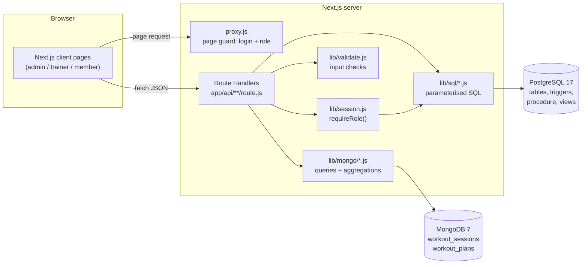

**Request flow (example: member checks in)**
1. The browser sends `POST /api/member/check-in` with the session cookie.
2. The route handler calls `requireRole('member')`. It verifies the JWT and checks in PostgreSQL that the account is active.
3. `checkIn()` runs `INSERT INTO check_ins (member_id) VALUES ($1)`.
4. The trigger `trg_checkin_requires_membership` either allows the row or raises an error.
5. `route()` in `lib/http.js` turns any error into JSON (`400 { error: "Check-in refused: …" }`), which the page shows.

## 12. Application screenshots

| | |
|---|---|
| 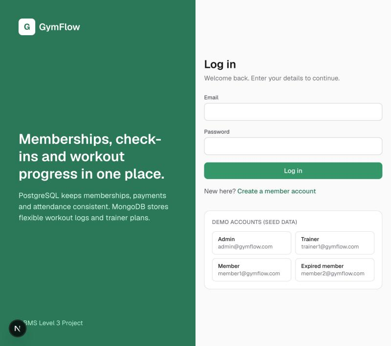 **1. Login with demo accounts** | 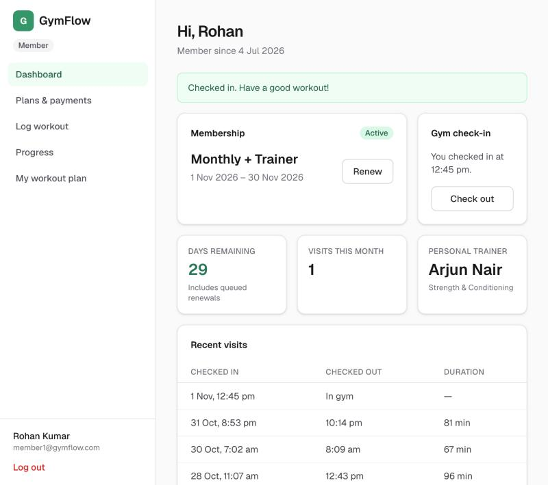 **2. Member dashboard after checking in** |
| 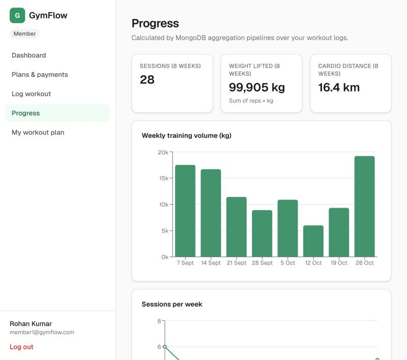 **3. Progress charts (MongoDB aggregation)** | 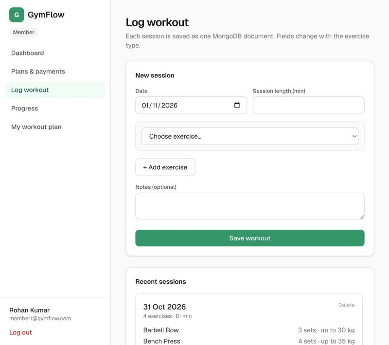 **4. Workout logger** |
| 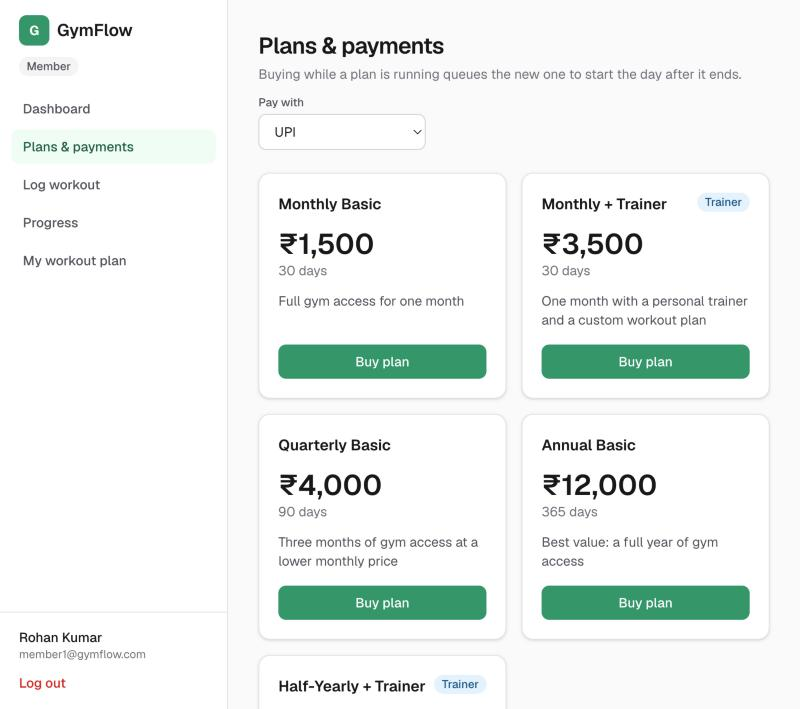 **5. Plans and purchase** | 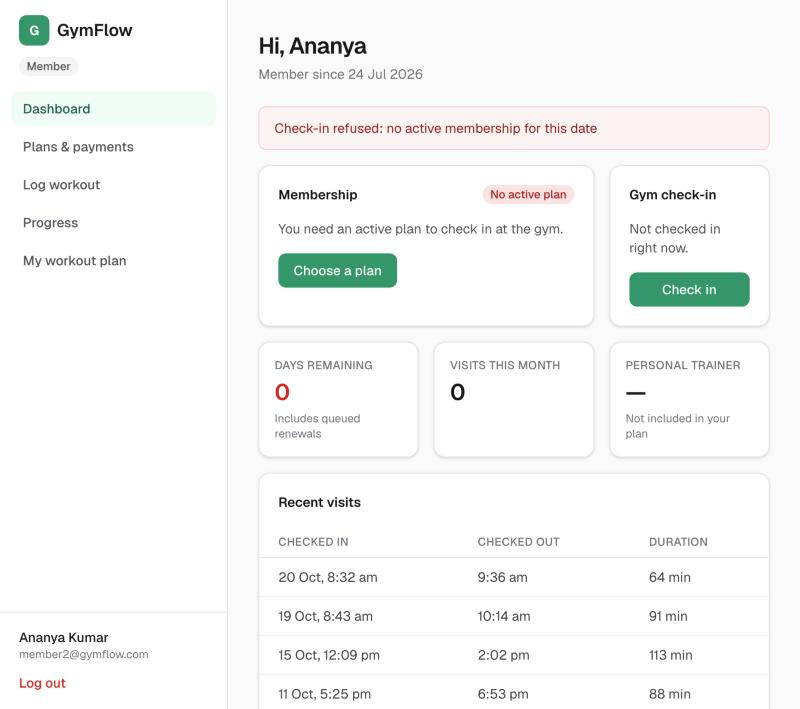 **6. Expired member's check-in refused by trigger** |
| 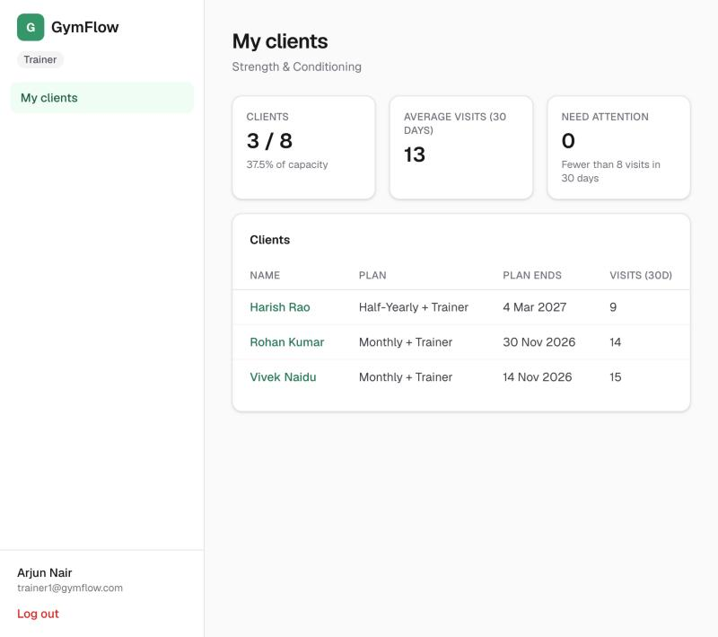 **7. Trainer's client list** | 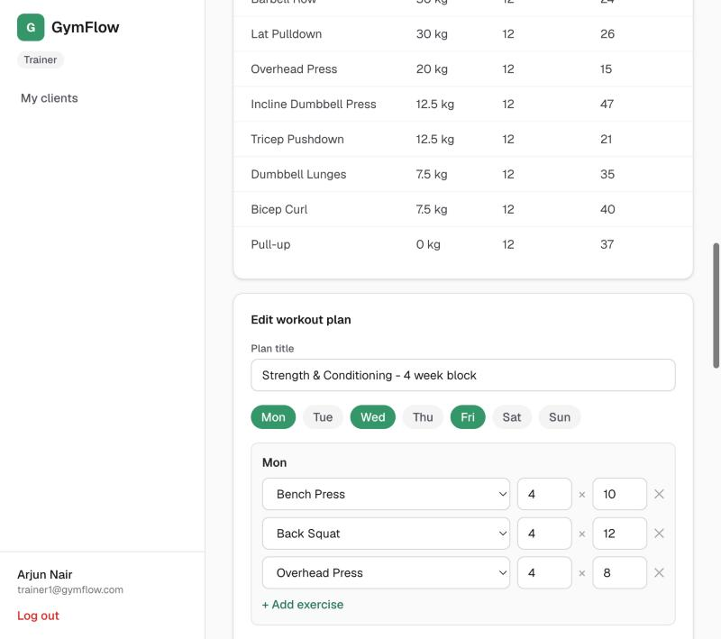 **8. Trainer editing a workout plan** |
| 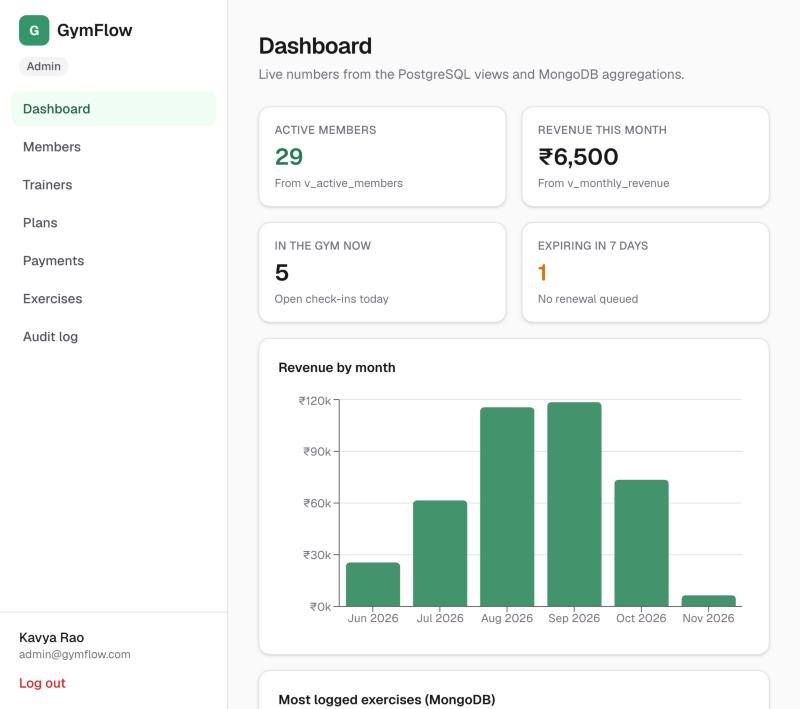 **9. Admin dashboard (views)** | 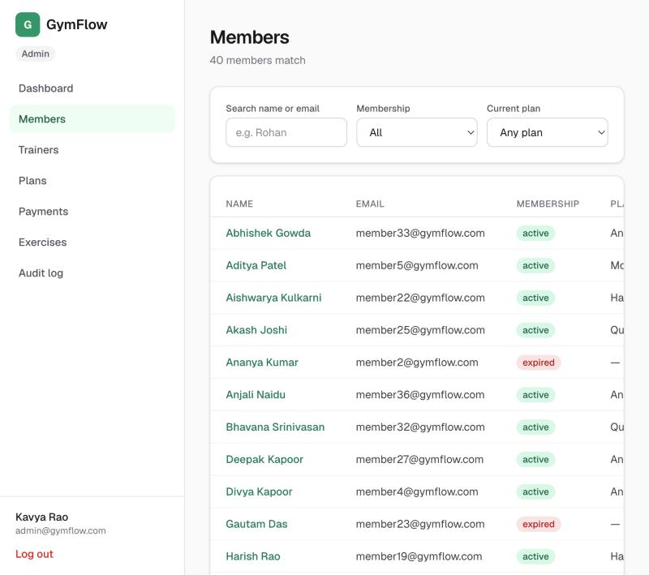 **10. Member search and filters** |
| 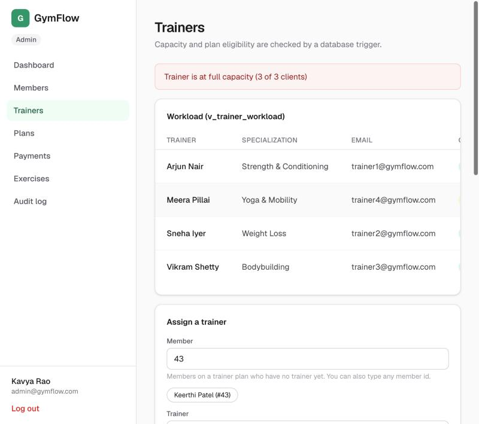 **11. Full trainer refused by trigger** | 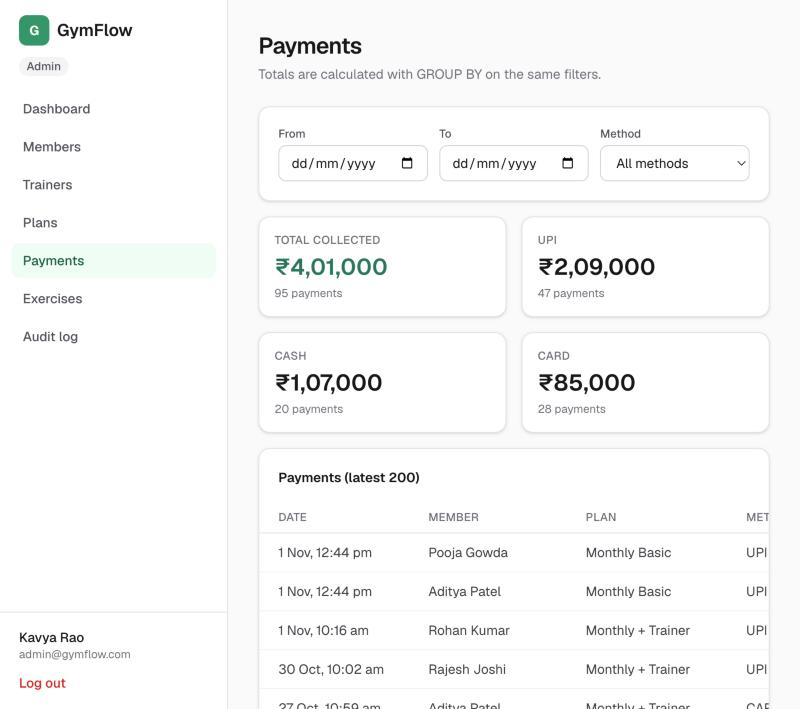 **12. Payments report with GROUP BY totals** |
| 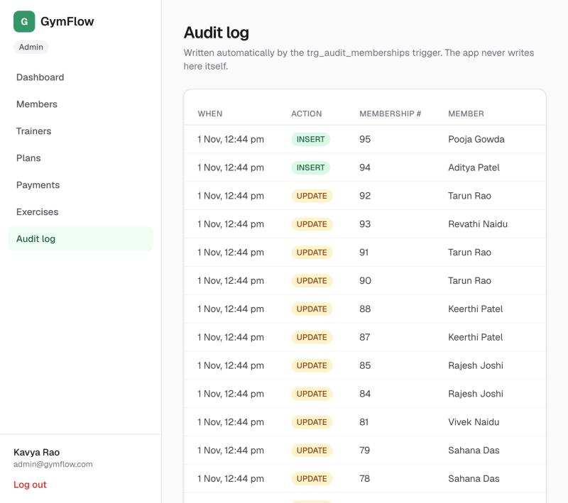 **13. Audit log written by trigger** | |

## 13. Testing results

### 13.1 Automated tests

Run with `npm test`. The tests use separate `gymflow_test` databases, which are rebuilt before each test file, so the demo data is never touched.

| File | What it covers | Tests |
|---|---|---|
| `tests/db-rules.test.js` | Triggers, procedure, transactions, views, constraints | 15 |
| `tests/mongo.test.js` | `$jsonSchema` validators, input parsing, aggregation pipelines | 9 |
| `tests/auth.test.js` | Hashing, JWT, tampered tokens, atomic sign-up | 6 |
| `tests/api-logic.test.js` | Dashboard, check-in/out, trainer ownership, cancel, search, delete | 8 |
| **Total** | | **38 passed, 0 failed** |

```
✔ check-in refused without active membership
✔ check-in refused when membership has expired
✔ check-in refused when the only membership starts in the future
✔ second open check-in same day refused
✔ purchase creates membership and payment at plan price
✔ renewal starts the day after current membership ends
✔ failed payment rolls back the membership
✔ purchase of an inactive plan is refused
✔ trainer at capacity is refused
✔ trainer requires a plan that includes one
✔ member cannot have two active trainers
✔ expire_memberships flips stale rows and audit_log records it
✔ days_remaining counts stacked memberships
✔ v_trainer_workload counts active clients
✔ check constraints reject bad email and zero price
✔ validator rejects strength exercise without sets
✔ validator rejects negative weight
✔ parseWorkoutInput rejects empty exercises and NaN reps
✔ parseWorkoutInput fills name and category from the catalog
✔ weeklyVolume sums reps x weight
✔ personalRecords returns max weight per exercise
✔ topExercises counts how often each exercise is logged
✔ aggregations return [] for a member with no sessions
✔ deleteSession only deletes the member's own session
✔ hash and verify password
✔ session token round-trips userId and role
✔ tampered token returns null
✔ registerMember stores a hashed password and a member profile
✔ registerMember rejects a duplicate email
✔ registerMember is atomic: a bad profile leaves no user row behind
✔ purchaseMembership returns the new id and records the payment
✔ getMemberDashboard shows upcoming-only member
✔ check in then check out; checkOut without open check-in throws 400
✔ isTrainerOfMember false for another trainer's client
✔ cancelling a trainer plan releases the trainer
✔ capacity cannot go below current client count
✔ searchMembers filters by status
✔ deletePlan in use is refused; unused plan is deleted
ℹ tests 38
ℹ pass 38
ℹ fail 0
```

### 13.2 Manual test cases (through the web interface / API)

| ID | Steps | Expected | Actual |
|---|---|---|---|
| TC1 | Log in with a wrong password | 401 "Invalid email or password" | Pass |
| TC2 | Open `/api/member/dashboard` without logging in | 401 "Please log in" | Pass |
| TC3 | Member opens `/api/admin/dashboard` | 403 "You do not have access to this" | Pass |
| TC4 | member1 clicks Check in, then Check in again | First succeeds; second "Check-in refused: already checked in" | Pass |
| TC5 | member1 checks out twice | Second "You are not checked in" | Pass |
| TC6 | member2 (expired) clicks Check in | "Check-in refused: no active membership for this date" | Pass |
| TC7 | Log a workout with empty reps | 400 "Exercise 1 set 1 reps must be a number" | Pass |
| TC8 | Log a workout dated in the future | 400 "Workout date cannot be in the future" | Pass |
| TC9 | Buy a plan with method "bitcoin" via the API | 400 "Payment method must be cash, card or upi", nothing saved | Pass |
| TC10 | Trainer opens another trainer's client page | 403 "This member is not one of your clients" | Pass |
| TC11 | Admin assigns a member to Meera Pillai (3/3) | "Trainer is at full capacity (3 of 3 clients)" | Pass |
| TC12 | Admin deletes "Monthly Basic" (sold 42 times) | 409 "This plan has been bought before…" | Pass |
| TC13 | Sign up with date of birth in 2020 | 400 "Members must be at least 14 years old"; no user created | Pass |
| TC14 | New member opens Progress and Dashboard | Empty states, no errors | Pass |
| TC15 | Trainer saves a workout plan; member opens My workout plan | Plan visible to the member | Pass |
| TC16 | Admin filters payments by method = cash | Only cash rows; totals recomputed | Pass |

## 14. Conclusion and future enhancements

GymFlow shows how the choice of database follows from the shape of the data:
- **PostgreSQL** holds money, identity and rules. Its constraints, triggers, a stored procedure and transactions guarantee that no membership exists without its payment, that nobody checks in without a valid plan, and that no trainer is overbooked.
- **MongoDB** holds nested, varied workout logs. Its validators keep that flexible data clean, and its aggregation pipelines turn it into progress charts.
- **The Next.js interface** makes each database feature visible. The errors users see are the database's own messages.

**Future enhancements**
- Online payments (Razorpay/Stripe) with webhook-confirmed transactions
- QR-code check-in at the gym entrance
- Email/SMS reminders for memberships about to expire (using the "ending soon" query)
- Class/slot booking with capacity limits (another trigger use case)
- Semantic search over workout notes with vector embeddings (pgvector)
- Multi-branch support, with a `branches` table and per-branch revenue views
- Scheduled `expire_memberships()` with pg_cron instead of running on dashboard load

## 15. Team contribution

The work was split into three areas. Each member owns both database work and the application screens built on it.

| Member | Area | Database work | Application work |
|---|---|---|---|
| **Akarsh Kumar Gupta** (PES1UG24AM021) | Relational design and reporting | ER diagram, relational schema, normalisation, data dictionary; tables, keys and constraints; views; indexes and the EXPLAIN ANALYZE study; important queries | Admin dashboard, member search and detail, plans, payments report, audit log |
| **Aryan Arora** (PES1UG24AM055) | Business rules and security | `purchase_membership` procedure, `days_remaining` and `expire_memberships` functions; the three triggers; transactions | Password hashing, JWT sessions and role checks; member dashboard and check-in; plan purchase; trainer assignment |
| **Ashwin Anand** (PES1UG24AM057) | MongoDB workout module and UI | MongoDB data model, `$jsonSchema` validators, indexes and aggregation pipelines; exercise catalog table and the PostgreSQL–MongoDB link; setup and seed scripts | Workout logger, progress charts, workout plan views, trainer client page and plan editor, app layout and shared components; README and report |

### Files owned by each member

| Akarsh Kumar Gupta | Aryan Arora | Ashwin Anand |
|---|---|---|
| `db/sql/00_drop.sql` | `db/sql/03_functions.sql` | `db/mongo/setup.js` |
| `db/sql/01_schema.sql` | `db/sql/04_triggers.sql` | `lib/mongo.js`, `lib/mongo/workouts.js`, `lib/mongo/plans.js` |
| `db/sql/02_alter.sql` | `lib/db.js` (transactions) | `lib/sql/exercises.js`, `lib/validate.js` |
| `db/sql/05_views.sql` | `lib/auth.js`, `lib/session.js`, `proxy.js` | `scripts/setup-db.js`, `scripts/seed.js` |
| `db/sql/06_indexes.sql` | `lib/sql/users.js`, `memberships.js`, `checkins.js`, `trainers.js` | `app/api/member/workouts`, `progress`, `workout-plan`; `app/api/trainer/clients/[id]`; `app/api/exercises` |
| `db/sql/queries.sql` | `lib/http.js` (error handling) | `app/member/workouts`, `progress`, `workout-plan` |
| `lib/sql/dashboard.js`, `members.js`, `payments.js`, `plans.js`, `audit.js` | `app/api/auth/*`, `app/api/member/{dashboard,check-in,check-out,memberships}` | `app/trainer/**`, `components/PlanEditor.js`, `ProgressCharts.js`, `WorkoutSummary.js`, `PlanView.js` |
| `app/api/admin/{dashboard,members,plans,payments,audit}` | `app/api/admin/{memberships,trainers,assignments}` | `app/login`, `app/register`, `components/Shell.js`, `ui.js`, `Charts.js`, `lib/client.js` |
| `app/admin/{page,members,plans,payments,audit}` | `app/member/page.js`, `app/member/plans`, `app/admin/trainers` | `app/admin/exercises`, `README.md`, `docs/` |
| Tests: views, constraints, member search, plan delete | Tests: triggers, procedure, transactions, auth, check-in/out, cancellation | Tests: `tests/mongo.test.js` |

## 16. Demo walkthrough

A suggested order for the final demonstration. Run `npm run db:reset` first for fresh data.

1. **Login page.** Point out the demo accounts. Passwords are bcrypt-hashed: `SELECT email, password_hash FROM users LIMIT 3;`
2. **member2 (expired) → Check in.** The trigger refuses it. Show `04_triggers.sql`.
3. **member1 → Check in, then Check in again.** Second refusal (same trigger, second rule).
4. **member1 → Plans → buy Monthly Basic.** Show in Membership history that the new plan starts the day after the current one ends. Show `purchase_membership` and `withTransaction`.
5. **member1 → Log workout.** Pick Bench Press (sets appear), then Treadmill Run (minutes/distance appear). Save, then show the document in MongoDB: `db.workout_sessions.find().sort({createdAt:-1}).limit(1)`
6. **member1 → Progress.** Explain the `weeklyVolume` aggregation pipeline.
7. **trainer1 → open Rohan Kumar → edit plan → Save.** Log back in as member1 → My workout plan.
8. **trainer1 → change the URL to another member's id.** 403 (ownership check).
9. **admin → Dashboard.** Each card names the view it comes from.
10. **admin → Trainers → assign Keerthi Patel to Meera Pillai.** The capacity trigger refuses it. Assign to Arjun Nair instead and it succeeds.
11. **admin → Plans → Delete Monthly Basic.** Refused by FK RESTRICT. Deactivate it instead.
12. **admin → Audit log.** Rows written by the trigger for the purchase made in step 4.
13. **Terminal:** `psql -d gymflow -f db/sql/queries.sql` to show joins, GROUP BY/HAVING, subqueries and EXPLAIN ANALYZE.
14. **Terminal:** `npm test`, 38 passing tests.
